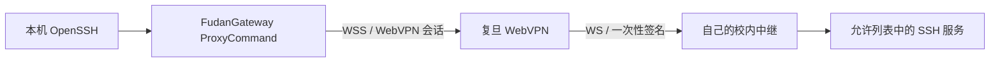

# FudanGateway · WebVPN 模式

使用复旦官方 UIS 登录 WebVPN，访问校园网页，并通过自己有权使用的校内中继，让
macOS 原生 `ssh` 连接校内服务器。SSH 私钥留在本机，主机密钥由 OpenSSH 严格校验。

这个模式不需要把 WebVPN Cookie 转换成 aTrust 凭证，也不安装 TUN 或修改系统代理、
DNS、全局路由。现有 Tailscale、v2rayN 和独立的 aTrust 实现可以保留。

**原生 SSH 需要校内中继。** 单独登录 WebVPN、打开它的 Guacamole 网页终端，并不能
让本机 OpenSSH 获得 TCP 通道。本仓库包含客户端、受控中继和 macOS 菜单栏界面。

## 安装

客户端要求 macOS 13+、Google Chrome、[uv](https://docs.astral.sh/uv/) 和 Python 3.11+。
校内中继要求 Linux、Python 3.11+，以及你有权使用的 SSH 服务。

```sh
git clone https://github.com/Biogod2020/fudan-gateway.git
cd fudan-gateway
uv sync --frozen --extra browser
uv tool install --force '.[browser]'
```

按 [中继部署说明](docs/relay-deployment.md) 部署中继，再填写 `examples/client.json`。
macOS 默认配置路径是：

```text
~/Library/Application Support/FudanGateway/webvpn/config.json
```

配置、WebVPN 会话、浏览器状态和中继密钥必须留在本机私有目录，文件权限为 `0600`。
配置中的绝对路径、用户名和允许连接的服务器需要按实际环境修改。只把信任的服务器
公钥放入独立的 `known_hosts`，不要关闭主机密钥校验。

## 日常使用

```sh
fudangateway login
fudangateway install-client --launch-agent
fudangateway doctor --native-ssh campus
ssh campus
```

`login` 打开官方 UIS 页面；密码不写入配置。后台登录助手只使用本机的 UIS 会话续期，
失效时要求重新登录。会话标记所属设备，客户端会在发送请求前拒绝使用其他机器的会话。
不要在机器之间复制 WebVPN Cookie。

`install-client` 为配置中的别名生成独立 SSH Include，保留原有配置并创建私有备份。
例如 `campus` 和 `campus-webvpn` 都通过 `ProxyCommand` 使用本模式。

```sh
fudangateway open                              # 打开已登录的校园资源入口
fudangateway open https://library.fudan.edu.cn/
fudangateway get https://library.fudan.edu.cn/  # 原生 HTTP 客户端读取
fudangateway probe campus                      # 验证真实 SSH banner
fudangateway status                            # 显示上次验证及时间
fudangateway stop                              # 停止登录助手
```

`connect` 的标准输出只传输 SSH 字节，不输出状态或日志。`doctor --native-ssh` 另外调用
本机 OpenSSH 完成真实的公钥登录检查；收到 banner 不等于通过服务器认证。

## 菜单栏界面

```sh
scripts/build-macos.sh
uv run --extra browser python scripts/install-menu.py dist/FudanGateway.app
```

安装后名为 **FudanGateway WebVPN.app**，与旧的 aTrust 菜单程序分开，支持 UIS 登录、
打开校园资源和原生 SSH 验证。“仅退出界面”保留登录助手和已建立的 SSH 会话。
停止登录助手也不会把已建立的 SSH 当作可恢复会话重新连接。

## 访问通路



中继目标由配置限制，连接请求经过 HMAC 签名、时间窗和防重放检查。WebVPN 使用其实际
`ws`/`wss` 资源路径进行 WebSocket 转发，外层始终使用 TLS。SSH 本身仍是端到端加密，
中继没有客户端 SSH 私钥。

本版本提供 WebVPN 模式；不捆绑 aTrust 客户端，不声称它的会话能绕过其他应用的认证
要求。网页中的具体业务系统仍可能需要自己的登录和访问权限。

## 开发和验证

当前实现已在 macOS 原生 OpenSSH 与两台校内 Linux 主机上进行实际验收：公钥登录、
校园网页读取、1 MiB 二进制校验、跨心跳长连接、中继重启后重新连接，以及登录助手
重启后使用已有 UIS 会话恢复。它不声称在中继重启时无损保持旧 SSH 会话。

```sh
uv sync --frozen --extra browser
uv run pytest -q
uv run ruff check src tests scripts
uv run ruff format --check src tests scripts
scripts/build-macos.sh
```

测试覆盖请求认证与重放、原始二进制传输、目标允许列表、设备会话隔离、Unix Socket
权限和异常脱敏、SSH 配置备份与保留。真实部署验收需要在自己的环境验证 UIS 登录、
网页读取、OpenSSH 公钥登录以及断线后新建连接。

运行状态不以“端口存在”或“Cookie 文件存在”为成功依据。诊断结果保留上次检查时间，
超过时限会显示待验证；网络中断和会话失效不会触发无限密码重试。
